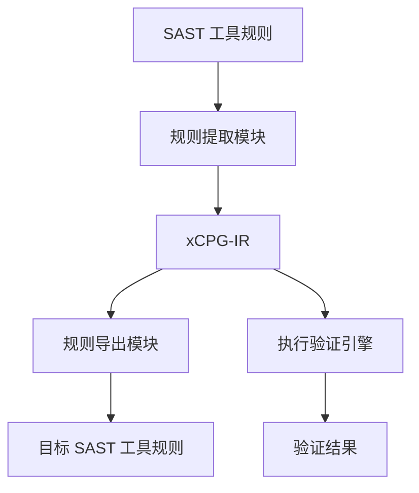

# B2RScan 架构设计

## 概述

B2RScan 是一个统一的漏洞检测规则框架，旨在解决多种 SAST 工具（如 Semgrep、CodeQL、Gosec、PMD 等）之间规则不兼容、难以复用和验证的问题。通过将不同工具的规则抽取为统一的中间表示（xCPG-IR），实现规则的集中管理与跨平台迁移。

## 核心组件

### 1. 规则提取模块 (Rule Extraction)

规则提取模块负责从各种 SAST 工具中提取规则并转换为统一的 xCPG-IR 格式。

主要组件：
- [RuleExtractor](../src/b2rscan/task/rule_extraction/extractor.py): 主要的规则提取器
- [Parser](../src/b2rscan/task/rule_extraction/parser/): 各种 SAST 工具规则解析器
- [IRConverter](../src/b2rscan/task/rule_extraction/ir_converter.py): IR 转换器

### 2. 统一 IR (xCPG-IR)

xCPG-IR 是项目的核心中间表示，具有以下字段：

- `id`: 规则唯一标识符
- `name`: 规则名称
- `description`: 规则描述
- `severity`: 严重性等级 (low, medium, high, critical)
- `sources`: 数据源点
- `sinks`: 数据汇点
- `sanitizers`: 净化函数
- `validators`: 验证函数
- `meta`: 元数据

### 3. SAST 工具理解模块

该模块通过智能体分析 SAST 工具的内部工作机制，并构建知识图谱。

主要组件：
- [SASTUnderstandAgent](../src/b2rscan/task/understanding/agent.py): SAST 工具理解智能体
- [ToolRegistry](../src/b2rscan/toolbox/tool_registry.py): 工具注册表

### 4. 大语言模型封装

项目支持多种大语言模型：

- OpenAI API
- 阿里云 DashScope (Qwen)

主要组件：
- [LLMWrapper](../src/b2rscan/llm_wrapper/wrapper.py): LLM 封装器
- [Factory](../src/b2rscan/llm_wrapper/factory.py): LLM 客户端工厂

## 数据流



## 模块交互

1. `agent_wrapper` 调用外部智能体获取原始规则
2. `rule_extraction.extractor_*` 模块处理规则解析与 IR 转换
3. `ir.schema.py` 定义 xCPG-IR 结构并做 Schema 校验
4. `llm_wrapper` 支持调用 OpenAI/DashScope 等 LLM 服务辅助理解
5. `toolbox` 提供通用工具（如 bash 执行、LLM 分析）
6. `monitor.logging` 统一日志输出

## 设计模式

- **插件化架构**: `task` 模块下按功能划分独立子任务（如 rule_extraction、understanding）
- **工厂模式**: `llm_wrapper/factory.py` 用于动态创建 LLM 客户端
- **策略模式**: 不同解析器（codeql_parser 等）实现统一接口，支持多工具适配
- **责任链模式**: task_flow.py 实现任务流程编排

## 技术栈

- Python 3.8+
- uv (包管理工具)
- OpenAI API / DashScope API
- 外部智能体 (如 trae-agent)

## 部署架构

```
┌─────────────────────────────────────────────┐
│                B2RScan                      │
├─────────────────────────────────────────────┤
│  ┌─────────────┐  ┌─────────────┐          │
│  │   LLM       │  │   Agent     │          │
│  │  Wrapper    │  │  Wrapper    │          │
│  └─────────────┘  └─────────────┘          │
├─────────────────────────────────────────────┤
│         规则提取    规则理解    规则导出     │
├─────────────────────────────────────────────┤
│  ┌─────────────┐  ┌─────────────┐          │
│  │   Parser    │  │ IR Schema   │          │
│  │             │  │             │          │
│  └─────────────┘  └─────────────┘          │
├─────────────────────────────────────────────┤
│              xCPG-IR 中间表示                │
└─────────────────────────────────────────────┘
```